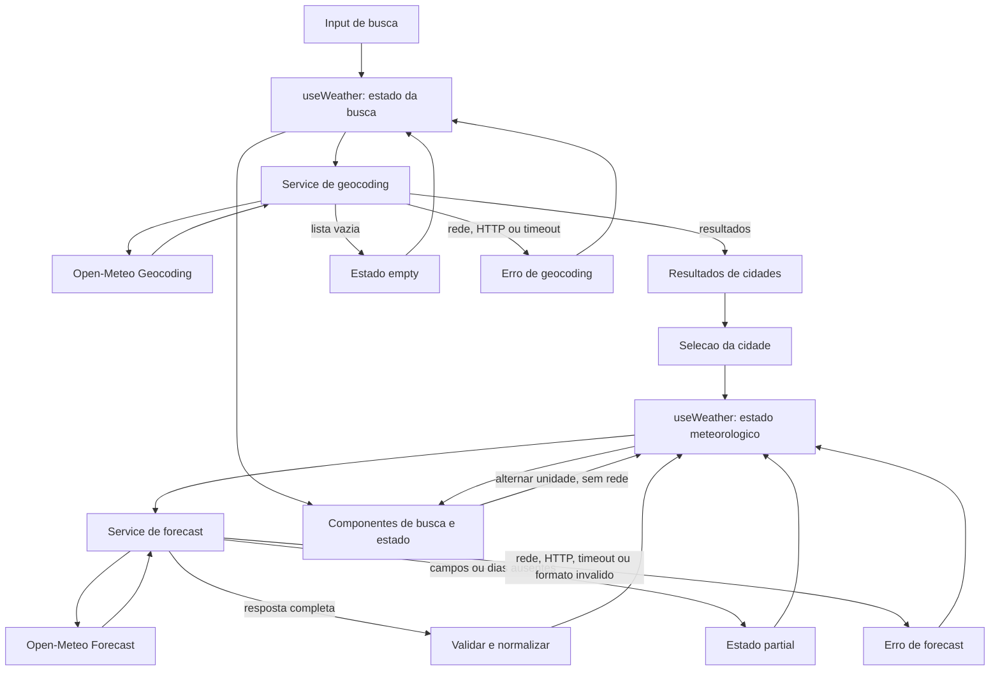

# Weather App — Plano Técnico

## Architecture

Aplicação client-side em React, organizada em quatro responsabilidades: componentes de apresentação, um hook de orquestração, serviços HTTP para Open-Meteo e funções puras de normalização/formatação. A UI não conhece URLs nem o formato bruto da API. O hook `useWeather` coordena busca, seleção, consulta meteorológica, estados e unidade.

Não adicionar backend: o provedor não requer API key e a especificação exclui autenticação e persistência de servidor. Manter a integração em serviços isolados permite substituir ou adaptar a fonte sem acoplar componentes.

### Architecture Overview e rastreabilidade

| Requisito da spec | Responsabilidade técnica |
|---|---|
| FR-01, FR-05: busca, vazio, carregamento e falhas | `CitySearch`, `useWeather` e `geocoding.ts`. |
| FR-02, FR-03: clima atual e cinco dias | `weather.ts` normaliza a resposta; `CurrentWeather` e `ForecastList` apresentam os dados. |
| FR-04: unidade | `UnitToggle` altera estado local; `temperature.ts` deriva a apresentação sem rede. |
| NFR-01, NFR-03: pt-BR e acessibilidade | Formatação em `lib/`; controles semânticos, labels e navegação por teclado nos componentes. |
| NFR-02, NFR-07: responsividade e navegadores | Tailwind e validação em viewports/browsers suportados. |
| NFR-04, NFR-05, NFR-06: feedback, renderização e timeout | Estado local imediato, atualização após normalização e cancelamento temporal no serviço. |
| NFR-08: privacidade | Sem login, geolocalização, armazenamento no servidor ou telemetria de usuário no escopo inicial. |

### Limites das camadas

- **Apresentação (`components`):** recebe dados, estados e callbacks por props; renderiza busca, clima, previsão e estados visuais. Não chama APIs nem contém regras de conversão.
- **Orquestração/estado (`hooks`):** `useWeather` coordena consulta, seleção, loading/empty/error/partial, retry e unidade. Chama serviços e entrega estado pronto para a tela.
- **Acesso a dados (`services`):** constrói requisições Open-Meteo, aplica timeout/cancelamento, valida respostas e as converte para os tipos do domínio. Não importa componentes React.
- **Funções puras (`lib`):** concentra conversão C/F, mapeamento de códigos WMO e formatação de datas. Não acessa rede, DOM ou estado React.

## Tech Stack

- **TypeScript strict**, **React 19** e **Vite** para aplicação e build.
- **Tailwind CSS** para estilos e responsividade, seguindo o tema existente do projeto.
- **Open-Meteo Geocoding e Forecast APIs** como fonte de localização e clima.
- **Vitest** e **Testing Library** para testes unitários e de componentes; **Playwright** para fluxos E2E.
- **Biome** para lint e formatação; **pnpm** como gerenciador de pacotes.
- APIs do navegador (`fetch`, `AbortController`, `Intl`) sem biblioteca adicional de estado ou cliente HTTP.

## Project Structure

```text
src/
├── components/
│   ├── CitySearch.tsx
│   ├── CurrentWeather.tsx
│   ├── ForecastList.tsx
│   ├── UnitToggle.tsx
│   └── states/
│       ├── LoadingState.tsx
│       ├── ErrorState.tsx
│       └── EmptyState.tsx
├── hooks/
│   └── useWeather.ts
├── services/
│   ├── geocoding.ts
│   └── weather.ts
├── lib/
│   ├── temperature.ts
│   ├── weather-code.ts
│   └── date.ts
├── types/
│   └── weather.ts
├── styles/
│   └── index.css
├── App.tsx
└── main.tsx

tests/
├── unit/
└── e2e/
```

Testes de funções, serviços, hooks e componentes ficam em `tests/unit/`; fluxos de navegador ficam em `tests/e2e/`. Manter componentes pequenos e sem acesso direto à rede. Reutilizar configuração já existente do repositório, sem introduzir camadas ou dependências adicionais sem necessidade.

Essa divisão permite validar cada camada sem executar as demais: `lib` com entradas e saídas determinísticas; `services` com `fetch` mockado; `hooks` com os serviços substituídos por mocks; componentes com props, Testing Library e `userEvent`; e o fluxo completo com Playwright interceptando a rede via `page.route`. Assim, falhas de lógica, contrato, interação e integração ficam localizadas e reproduzíveis.

## Data Model

Contratos TypeScript propostos. Valores meteorológicos ausentes são `null` após normalização; não se inventam valores para completar uma resposta.

```ts
export type Unit = "celsius" | "fahrenheit";
export type SearchStatus = "idle" | "loading" | "success" | "empty" | "error";
export type WeatherStatus = "idle" | "loading" | "success" | "partial" | "error";
export type WeatherErrorCode = "network" | "timeout" | "http" | "invalid-response";

export interface City {
  name: string; // Nome da cidade retornado pelo geocoding.
  latitude: number; // Latitude usada para consultar a previsão.
  longitude: number; // Longitude usada para consultar a previsão.
  country: string; // País retornado para distinguir cidades homônimas.
  countryCode?: string; // Código ISO do país, quando disponível.
  admin1?: string; // Região administrativa, quando disponível.
  timezone?: string; // Fuso IANA retornado pelo geocoding, quando disponível.
}

export interface CurrentWeather {
  temperatureCelsius: number | null; // current.temperature_2m normalizada para Celsius.
  weatherCode: number | null; // current.weather_code (código WMO) para mapear a condição.
}

export interface ForecastDay {
  date: string; // daily.time no formato ISO YYYY-MM-DD, no fuso da cidade.
  minimumCelsius: number | null; // daily.temperature_2m_min em Celsius.
  maximumCelsius: number | null; // daily.temperature_2m_max em Celsius.
  weatherCode: number | null; // daily.weather_code (código WMO) para mapear a condição.
}

export interface WeatherData {
  city: City; // Cidade selecionada para esta consulta.
  timezone: string; // Fuso retornado pelo endpoint Forecast (timezone=auto).
  current: CurrentWeather; // Condições atuais normalizadas.
  forecast: ForecastDay[]; // Cinco dias ordenados; campos sem dados ficam null.
}

export interface WeatherViewState {
  query: string; // Texto atual da busca.
  searchStatus: SearchStatus; // Estado do fluxo de geocoding.
  searchResults: City[]; // Resultados selecionáveis da busca.
  selectedCity: City | null; // Cidade escolhida pela pessoa.
  weatherStatus: WeatherStatus; // Estado da consulta atual/previsão.
  weather: WeatherData | null; // Dados da cidade selecionada, se disponíveis.
  unit: Unit; // Unidade de apresentação, sem alterar os dados canônicos.
  errorCode: WeatherErrorCode | null; // Categoria técnica do erro atual.
  errorMessage: string | null; // Mensagem de erro localizada em pt-BR.
}
```

Invariantes: `forecast` é normalizado para cinco posições em ordem de data local; campos meteorológicos ausentes ficam `null` e `weatherStatus` passa a `partial`. `WeatherData` armazena temperaturas em Celsius como valor canônico; conversão e formatação são de apresentação. Fahrenheit usa a fórmula $F = C \times 9/5 + 32$ e arredondamento ao inteiro mais próximo, com empates para longe de zero. A identidade de seleção é a combinação de nome, coordenadas e país, sem depender de um ID opcional do provedor.

## Data Flow



1. A pessoa envia uma consulta; `useWeather` rejeita input vazio e `geocoding.ts` codifica a consulta.
2. Resultados permitem selecionar uma cidade; uma lista vazia e falhas atualizam os estados `empty` e `error`, respectivamente.
3. Após a seleção, `useWeather` solicita o forecast para latitude/longitude.
4. `weather.ts` valida e normaliza a resposta; dados incompletos seguem o estado `partial`.
5. O hook atualiza o estado e os componentes renderizam os dados ou estados correspondentes.
6. Alternar unidade deriva Fahrenheit de valores Celsius no cliente, sem chamar a API.

## External APIs

### Geocoding

- **Método/URL:** `GET https://geocoding-api.open-meteo.com/v1/search?name={query}&count=5&language=pt&format=json`
- **Parâmetros relevantes:** `name` é obrigatório e deve ser codificado com `URLSearchParams`; `count=5` limita os candidatos; `language=pt` solicita nomes em português; `format=json` deixa explícito o formato esperado.
- **Resposta resumida:**

```json
{
  "results": [
    {
      "name": "Campinas",
      "latitude": -22.9056,
      "longitude": -47.0608,
      "country": "Brasil",
      "country_code": "BR",
      "admin1": "São Paulo",
      "timezone": "America/Sao_Paulo"
    }
  ]
}
```

- **Mapeamento:** cada item de `results` vira um `City`: `name`, `latitude`, `longitude` e `country` são campos base; `country_code` vira `countryCode`, `admin1` permanece `admin1` e `timezone` é opcional. `results: null` ou `[]` numa resposta válida significa `empty`; campo ausente ou com tipo inválido significa `invalid-response`.

### Forecast

- **Método/URL:** `GET https://api.open-meteo.com/v1/forecast?latitude={latitude}&longitude={longitude}&current=temperature_2m,weather_code&daily=weather_code,temperature_2m_max,temperature_2m_min&forecast_days=5&timezone=auto&temperature_unit=celsius`
- **Parâmetros relevantes:** `latitude` e `longitude` vêm do `City` selecionado; `current` e `daily` limitam a resposta aos campos necessários; `forecast_days=5` solicita hoje e os quatro dias seguintes; `timezone=auto` usa o fuso local da coordenada; `temperature_unit=celsius` mantém Celsius como valor canônico.
- **Resposta resumida:**

```json
{
  "timezone": "America/Sao_Paulo",
  "current_units": { "temperature_2m": "°C", "weather_code": "wmo code" },
  "current": { "time": "2026-11-05T12:00", "temperature_2m": 24.3, "weather_code": 1 },
  "daily_units": {
    "time": "iso8601",
    "weather_code": "wmo code",
    "temperature_2m_max": "°C",
    "temperature_2m_min": "°C"
  },
  "daily": {
    "time": ["2026-11-05", "2026-11-06", "2026-11-07", "2026-11-08", "2026-11-09"],
    "weather_code": [1, 2, 3, 1, 0],
    "temperature_2m_min": [17.1, 18.0, 17.4, 16.9, 17.2],
    "temperature_2m_max": [28.2, 27.5, 26.8, 29.0, 30.1]
  }
}
```

- **Mapeamento para `CurrentWeather`:** `current.temperature_2m` vira `temperatureCelsius`; `current.weather_code` vira `weatherCode`. O código WMO é traduzido para rótulo pt-BR por `weather-code.ts`, não substituído no modelo.
- **Mapeamento para `ForecastDay`:** combinar os arrays `daily.time`, `daily.weather_code`, `daily.temperature_2m_min` e `daily.temperature_2m_max` pelo mesmo índice. `time` vira `date`; os outros campos viram `weatherCode`, `minimumCelsius` e `maximumCelsius`.
- **Mapeamento para `WeatherData`:** compor `city` com o `City` selecionado, `timezone` com a resposta, e `current`/`forecast` com os dados normalizados. Normalizar cinco datas consecutivas; valores/campos ausentes ficam `null` e tornam `weatherStatus` `partial`.
- **Unidade:** `Unit` não vem da API. Inicia em `celsius`; a seleção `fahrenheit` é estado de apresentação e não altera os parâmetros nem provoca nova requisição.
- **Acesso:** nenhuma das chamadas requer API key; não incluir credenciais no cliente.

## State Management

O estado da aplicação vive em um único `useReducer` encapsulado no hook `useWeather`, instanciado por `App`. O hook é a fonte de verdade para busca, seleção, clima, previsão, unidade e erros; `App` repassa dados e callbacks aos componentes por props. Não usar Context global, Redux ou armazenamento no navegador: há uma tela e a spec exclui persistência.

| Estado | Significado |
|---|---|
| `idle` | Fluxo ainda não iniciado ou sem cidade selecionada. |
| `loading` | Requisição em andamento; apresentar indicador de carregamento. |
| `success` | Resposta válida e completa pronta para exibição. |
| `empty` | Busca de geocoding concluída com sucesso, sem cidades correspondentes; não é erro. |
| `error` | Falha de rede, HTTP, timeout ou formato inválido; mostrar erro e retry. |
| `partial` | Resposta meteorológica válida, mas com campo ou dia faltante; mostrar dados disponíveis e marcar lacunas. |

Manter `searchStatus` e `weatherStatus` separados: `searchStatus` usa `idle | loading | success | empty | error`; `weatherStatus` usa `idle | loading | success | partial | error`. `empty` pertence à busca; `partial` pertence aos dados meteorológicos.

- `unit` inicia em `celsius` e permanece apenas em memória durante a sessão.
- Dados meteorológicos são armazenados em Celsius. Na renderização, um helper puro recebe o valor canônico e `unit`, converte com $F = C \times 9/5 + 32$ quando necessário, arredonda ao inteiro mais próximo com empates para longe de zero e inclui o rótulo `°C` ou `°F`.
- A alternância atualiza apenas `unit`; não modifica os dados meteorológicos nem dispara requisição. Após reload, o padrão volta a Celsius.
- Ao enviar nova busca não vazia, cancelar consultas pendentes e limpar cidade/dados anteriores. Ao selecionar outra cidade, limpar o clima anterior antes de carregar o novo.
- Usar `AbortController` e um identificador de requisição; respostas antigas são ignoradas. Cancelamento por substituição de consulta não deve produzir erro visível.
- A ação de retry repete somente a operação que falhou (geocoding ou forecast), sem repetir operações já bem-sucedidas.

## Error Handling

- **Rede:** rejeição de `fetch` (offline/DNS/conexão) vira `network`; encerrar loading, mostrar mensagem pt-BR e oferecer retry.
- **API/HTTP:** status não-2xx vira `http`, preservando o status para diagnóstico interno. Validar JSON e formato; payload estruturalmente inválido vira `invalid-response`. Não expor detalhes técnicos na mensagem ao usuário.
- **Sem resultados:** `results: null` ou `results: []` numa resposta de geocoding válida produz `searchStatus=empty`, preserva a consulta e não chama Forecast; não mostrar como falha.
- **Timeout:** cada chamada externa expira em 10 segundos via `AbortController` e vira `timeout`. Distinguir esse caso do abort silencioso causado por uma busca/cidade mais recente.
- **Resposta parcial:** aceitar payload com estrutura válida e campos meteorológicos ausentes. Normalizar campo ausente como `null`, marcar `weatherStatus=partial`, exibir valores válidos e identificar cada lacuna. Para previsão, manter as cinco datas esperadas e marcar dias sem dados como indisponíveis.
- **Estado após falha:** limpar os dados da cidade anterior quando uma nova busca é enviada; não apresentar dados antigos como atuais. Retry manual repete apenas a chamada que falhou.
- **Concorrência:** respostas de consultas canceladas ou substituídas são ignoradas e não alteram status, erro ou dados da consulta ativa.

## Testing Strategy

- **Funções puras (Vitest):** testar `temperature.ts` com C/F, negativos, valores de empate arredondados para longe de zero e valores ausentes; testar `weather-code.ts` com códigos conhecidos e desconhecidos; testar formatação de data/fuso e normalização das cinco posições da previsão.
- **Services (Vitest):** substituir `fetch` por mock e usar fixtures para geocoding e forecast. Cobrir sucesso, lista vazia, HTTP não-2xx, JSON inválido, estrutura inválida, timeout, resposta parcial e valores ausentes. Verificar URL/parâmetros e mapeamento para os tipos internos. Nenhum teste unitário chama Open-Meteo real.
- **Hooks (Vitest/Testing Library):** substituir services por mocks e validar transições idle → loading → success/empty/error/partial, seleção de cidade, retry somente da operação falha, cancelamento e resposta fora de ordem. Verificar que mudar `Unit` não chama novamente o service.
- **Componentes (Testing Library):** renderizar `CitySearch`, `CurrentWeather`, `ForecastList`, `UnitToggle` e componentes de estado com props controladas. Cobrir loading, erro, vazio, sucesso e parcial; interação por teclado, roles/labels, conteúdo em pt-BR e mudança visível de unidade.
- **E2E (Playwright):** cobrir busca e seleção de cidade, apresentação do clima atual e cinco dias, alternância C/F, busca sem resultados e recuperação de falha. Interceptar chamadas com `page.route` e fixtures determinísticas; não depender da API pública.
- **Viewport mobile:** executar o fluxo principal em 320 px e em desktop. Verificar que controles permanecem utilizáveis, não há sobreposição e `scrollWidth <= clientWidth`; incluir navegação por teclado no fluxo de busca.
- **NFRs:** com rede mockada, medir feedback em até 100 ms desde a ação e renderização em até 500 ms após a resposta; validar teclado/roles e rodar smoke tests nos navegadores definidos em NFR-07. Tratar esses limites como metas da spec, não como medição da latência externa.
- **Validação do projeto:** `pnpm lint`, `pnpm build`, `pnpm test` e `pnpm test:e2e` quando o E2E estiver implementado.

## Risks & Trade-offs

| Decisão adotada | Alternativas consideradas | Trade-off e mitigação |
|---|---|---|
| Chamar Open-Meteo do navegador via services. | Criar backend/proxy próprio. | Evita infraestrutura e credenciais, pois a API não requer chave; aumenta dependência direta do provedor. Isolar o cliente HTTP, tratar erros/timeouts e validar termos/limites antes da publicação. |
| Não adicionar cache no MVP. | Cache em memória ou persistência local com TTL. | Menos estado e menor risco de dados antigos, mas sem fallback offline. Adicionar cache só se houver requisito de disponibilidade/frescor definido. |
| Usar `useReducer` local em `useWeather`. | Context global ou store como Redux/Zustand. | Mantém transições relacionadas co-localizadas sem dependência adicional; atende a uma única tela. Reavaliar apenas se surgirem múltiplas telas consumidoras. |
| Armazenar temperaturas canônicas em Celsius e converter na renderização. | Solicitar novamente à API na unidade escolhida ou armazenar ambas as unidades. | Alterna sem rede e evita duplicação; exige regra de arredondamento consistente. Centralizar a conversão em função pura e testá-la. |
| Usar `fetch` nativo com validação nos services. | Adotar cliente HTTP ou biblioteca de query/cache. | Sem dependência adicional e suficiente para duas operações simples; retry/cache automáticos ficam fora. Adotar biblioteca apenas se requisitos futuros justificarem a complexidade. |
| Usar mocks para testes de services e E2E. | Testar contra Open-Meteo real. | Fixtures tornam os testes determinísticos e independentes de rede/limites; não detectam sozinhas mudanças reais no provedor. Validar contrato externo em revisão controlada, sem tornar testes comuns dependentes da API. |
| Metas de desempenho e compatibilidade definidas na spec. | Avaliar apenas qualitativamente. | Metas permitem aceite verificável, mas dependem de ambiente de medição e matriz de navegadores. Confirmar esses parâmetros antes do release. |
